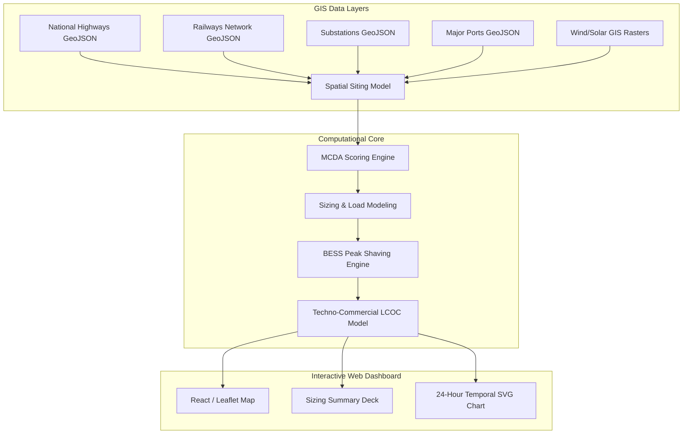

# METHODOLOGY: Electric Freight Corridor Grid-Readiness & Siting Model

This document outlines the engineering algorithms, mathematical models, GIS data pipelines, and global planning standards implemented in the **Electric Freight Corridor Grid-Readiness Assessment & Charging Infrastructure Siting Model** for SFC India.

---

## 1. Project Context & Systems Architecture
Heavy-duty freight electrification requires aligning transport logistics with the power grid. A single heavy-duty electric truck (HDT) requires battery packs ranging from $300$ to $1200\text{ kWh}$ and high-power fast charging (Megawatt Charging Systems - MCS). 

To de-risk corridor planning, this model couples spatial logistics data with power systems constraints using a four-layer architecture:



---

## 2. GIS & Data Pre-Processing Pipelines

All spatial coordinate layers are projected from EPSG:4326 (WGS 84) to UTM Zone 43N (**EPSG:32643**) for metric flat-plane calculations, ensuring high precision for line routing:
$$(x, y) = \text{Project}(Lon, Lat)$$

### A. Substation Connection Point
* **The Logic**: To identify where a charging station can connect to the grid, we locate the nearest electrical substation.
* **The Algorithm**: Spatial **KD-Tree Nearest-Neighbor Index Search** in projected coordinate space.
* **Mathematics**:
  $$\text{Feeder Distance (km)} = \frac{\sqrt{(x_{\text{hub}} - x_{\text{sub}})^2 + (y_{\text{hub}} - y_{\text{sub}})^2}}{1000}$$
* **Standard Reference**: **Open Geospatial Consortium (OGC) Simple Feature Access Standards**.

### B. Inland Rail Yards & Terminal Proximity (Multimodal)
* **The Logic**: Planners need to identify hubs capable of road-to-rail intermodal transfers. 
* **The Algorithm**: Spatial distance calculation from the candidate hub point to the nearest line segment in the simplified **Indian Railways network** (`indian_railways_simple.geojson`).
  $$\text{Rail Distance (km)} = \frac{\min\left(\text{Distance}(\text{geometry}_{\text{hub}}, \text{geometry}_{\text{railway\_segments}})\right)}{1000}$$
* **Standard Reference**: OGC Simple Feature Access.

### C. Major Ports Siting Proximity
* **The Logic**: Major ports are the primary anchor hubs generating heavy cargo flows. We compile coordinates of India's 12 major cargo ports into `india_major_ports.geojson`.
* **The Algorithm**: Spatial nearest-neighbor distance calculation between the candidate hub and the nearest port node:
  $$\text{Port Distance (km)} = \frac{\min\left(\text{Distance}(\text{geometry}_{\text{hub}}, \text{geometry}_{\text{major\_ports}})\right)}{1000}$$

### D. Environmental GIS Raster Sampling
* **The Logic**: To determine wind and solar potential, we sample raster datasets (GeoTIFFs) at the exact coordinates of each candidate hub.
* **The Algorithm**: Bilinear interpolation sampling using `rasterio`.
  $$V_{\text{wind}} = \text{sample}(Raster_{\text{wind}}, [Lon, Lat])$$
  $$P_{\text{solar}} = \text{sample}(Raster_{\text{solar}}, [Lon, Lat])$$
* **Data Sources**: **Global Wind Atlas** ($10\text{m}$ height raster) and **Global Solar Atlas** (power density raster).

---

### 3. Siting Deliverables & Siting Suitability Scoring

### A. Siting Output: Ranked List of Candidate Hubs
Ultimately, the SITING MODEL outputs a **ranked list of 120 candidate heavy-duty electric vehicle (HDT) charging hubs** along India's major national highway corridors. 
* **Prioritization Vector**: The candidate hubs are sorted by their **Composite Suitability Score (0 to 100)**.
* **Planning Utility**: Rather than selecting sites on ad-hoc logistics criteria, the model allows utility engineers and corridor planners to identify locations that minimize capital grid connection costs (CapEx) while maximizing charging utility (drayage, multimodal logistics, renewable capacity).
* **Rank Sensitivity**: Users can dynamically shift weights between Grid Connectivity, Renewable Potential, Substation Power Capacity, and Multimodal Logistics (Rail Proximity) to instantly re-rank the 120 hubs based on strategic priorities (e.g., a "Green-First" vs. a "Grid-First" development strategy).

### B. Siting Criteria Formulation (MCDA)
To evaluate candidate locations, we implement a Weighted Linear Combination (WLC) derived from the **Analytic Hierarchy Process (AHP)** (Saaty, 1980):

$$\text{Suitability Score} = 100 \times \left( f_{\text{grid}} \cdot S_{\text{grid}} + f_{\text{renew}} \cdot S_{\text{renew}} + f_{\text{power}} \cdot S_{\text{power}} + f_{\text{multi}} \cdot S_{\text{multi}} \right)$$

Where:
* $S_{\text{grid}}$: Grid proximity score (60% distance to substation, 40% connection voltage capacity).
* $S_{\text{renew}}$: Average of wind speed potential and solar power density.
* $S_{\text{power}}$: Capacity headroom score (1.0 if peak load fits within substation limit, scaling down to 0.0 if overload is massive).
* $S_{\text{multi}}$: Multimodal proximity score (distance to nearest rail line).
* $f_j$: Normalized weights specified by the planner ($f_j = w_j / \sum w_k$).

---

## 4. Grid Readiness Index (GRI %) Scorecard

### A. Mathematical Formulation
The **Grid Readiness Index (GRI %)** is a specialized engineering scorecard ($0\text{--}100\%$) indicating how easily a substation can receive a charging hub's high-power load without causing transformer overloading or distribution instability:

$$\text{GRI} = 100 \times \left( 0.4 \cdot S_{\text{voltage}} + 0.35 \cdot S_{\text{headroom}} + 0.25 \cdot S_{\text{dist}} \right)$$

Where:
1. **Voltage Class Score ($S_{\text{voltage}}$)**: Reflects copper capacity and connection stability. Higher voltage classes handle high charging loads with less line loss.
   - $220\text{ kV} \rightarrow 1.0$
   - $132\text{ kV} \rightarrow 0.8$
   - $110\text{ kV} \rightarrow 0.7$
   - $33\text{ kV} \rightarrow 0.5$
   - $11\text{ kV} \rightarrow 0.3$
2. **Substation Load Headroom ($S_{\text{headroom}}$)**: Evaluates the remaining transformer thermal capacity after BESS peak shaving:
   $$S_{\text{headroom}} = \max\left(0, 1 - \frac{\text{Peak Load}_{\text{shaved}}}{\text{Capacity Limit}}\right)$$
3. **Feeder Line Distance ($S_{\text{dist}}$)**: Penalizes hubs that require long overhead line runs, which cause high voltage drop ($\Delta V$) and high installation costs:
   $$S_{\text{dist}} = 1 - \frac{\text{Distance}_{\text{substation}}}{\text{Max Substation Distance in Network}}$$

### B. Standard Reference
* **IEEE 1547 (Standard for Interconnection and Integration of Distributed Energy Resources with Associated Transmission/Distribution Interfaces)**: Governs connection voltage requirements, voltage regulation limits, and transient response metrics.
* **EPRI Distribution Capacity Planning Guidelines**: Defines the use of capacity headroom factors and distance penalties for planning feeder lines to fast-charging stations.

---

## 5. Heavy-Duty Freight Sizing & Port Drayage Analysis

### A. Energy & Peak Load Sizing
For a given candidate hub, daily energy demand ($E_{\text{daily}}$) is computed as:

$$E_{\text{daily}}\text{ (MWh)} = \frac{N_{\text{trucks}} \cdot M_{\text{drayage}} \cdot C_{\text{battery}}\text{ (kWh)}}{1000}$$

Where:
* $N_{\text{trucks}}$: Base daily trucks requiring charging.
* $C_{\text{battery}}$: Nominal truck battery capacity in kWh (default: $600\text{ kWh}$).
* $M_{\text{drayage}}$: Port drayage scaling coefficient.

### B. Port Drayage Electrification Indicator
* **Siting Logic**: Drayage refers to short-distance cargo shipping between ports and inland logistics hubs (rail yards, warehouses). Because these trucks operate on fixed, predictable routes, drayage is universally identified as the most commercially viable first mover for commercial vehicle electrification.
* **Calculation Methodology**: The model calculates the metric distance to the nearest major port using projected metric coordinates (UTM Zone 43N). If the hub lies within a **$80\text{ km}$** buffer of any of India's 12 major ports, it is flagged as a Port Drayage hub:
  $$M_{\text{drayage}} = \begin{cases} 1.5 & \text{if } \text{Distance}_{\text{port}} \le 80\text{ km} \\ 1.0 & \text{otherwise} \end{cases}$$
  The **$1.5\times$** multiplier scales the daily trucks to represent the high cargo traffic densities typical of port-adjacent corridors.
* **Standard Reference**: **Smart Freight Centre (SFC) GLEC Framework (Global Logistics Emissions Council)** and **EPA Port Drayage Electrification Sizing Guidelines**.

### C. 24-Hour Temporal Load Curve
To simulate grid load over time, we map daily energy demand to hourly load shapes based on travel-behavior studies (similar to the **NREL EVI-Pro** model):

$$\text{Load}_t\text{ (MW)} = \text{Distribution}_t \cdot E_{\text{daily}}$$

1. **Overnight Depot** ($F_{\text{peak}} = 1.2$): Peak charging occurs between 22:00 and 04:00 during mandatory driver layovers.
2. **Midday Opportunity** ($F_{\text{peak}} = 1.6$): High, sharp power spikes between 11:00 and 15:00 during lunch and rest breaks.
3. **Continuous Logistics** ($F_{\text{peak}} = 0.9$): Flat, distributed load profiles typical of high-turnover hubs.

---

## 6. BESS Integration & Peak Shaving Algorithm

To reduce peak grid load and avoid overloading local substations, the model integrates a dynamic **Battery Energy Storage System (BESS)**.

### A. Mathematical Logic
For each hour $t \in [0, 23]$:
1. **Raw Hourly Load**: $\text{Load}_t$ (MW)
2. **Average Load**: $\text{Load}_{\text{avg}} = \frac{1}{24}\sum \text{Load}_t$
3. **BESS C-Rate Cap**: Charging/discharging rates are restricted to a 4-hour cycle rate ($C/4$ or $0.25\text{C}$):
   $$\text{BESS Limit (MW)} = \frac{\text{BESS Capacity (MWh)}}{4}$$
4. **Active Peak Shaving / Valley Filling**:
   - If $\text{Load}_t > \text{Load}_{\text{avg}}$: BESS discharges to support the grid. The discharge amount is restricted by the peak shaving limit (up to 35% of peak load) and the remaining State of Charge ($\text{SOC}_t$):
     $$\text{Discharge}_t = \min\left(\text{Load}_t - \text{Load}_{\text{avg}}, \text{BESS Limit}, \text{SOC}_t\right)$$
     $$\text{SOC}_{t+1} = \text{SOC}_t - \text{Discharge}_t$$
     $$\text{Shaved Load}_t = \text{Load}_t - \text{Discharge}_t$$
   - If $\text{Load}_t < \text{Load}_{\text{avg}}$: BESS charges from the grid to soak up off-peak power:
     $$\text{Charge}_t = \min\left(\text{Load}_{\text{avg}} - \text{Load}_t, \text{BESS Limit}, \text{BESS Capacity} - \text{SOC}_t\right)$$
     $$\text{SOC}_{t+1} = \text{SOC}_t + \text{Charge}_t$$
     $$\text{Shaved Load}_t = \text{Load}_t + \text{Charge}_t$$
5. **Net Peak Grid Demand**:
   $$\text{Peak}_{\text{shaved}}\text{ (MW)} = \max\left(\text{Shaved Load}_t\right)$$

### B. Standard Reference
* **IEEE Std 2030.2 (Guide for the Design, Operation, and Integration of Distributed Energy Storage Systems with Power Distribution Infrastructures)**: Dictates charge/discharge cycles, efficiency loss assumptions, and peak shaving load leveling standards.

---

## 7. Substation Capacity Constraints & Upgrade Cost Model

### A. Central Electricity Authority (CEA) Substation Thermal Limits
The thermal capacity limit of the nearest substation is determined by its voltage class rating, in accordance with the **Central Electricity Authority (CEA) of India Grid Standards**:
- $\ge 220\text{ kV} \rightarrow 150\text{ MW}$ capacity limit
- $132\text{--}110\text{ kV} \rightarrow 80\text{ MW}$ capacity limit
- $33\text{ kV} \rightarrow 35\text{ MW}$ capacity limit
- $11\text{ kV} \rightarrow 15\text{ MW}$ capacity limit

If $\text{Peak}_{\text{shaved}} > \text{Capacity Limit}$, a **Grid Overload Risk** is flagged in the application dashboard.

### B. Grid Upgrade CapEx (₹ Crores)
When connecting a high-power charging hub, developers are billed for dedicated extension feeders and substation transformer upgrades:

$$\text{Upgrade CapEx} = \left(\text{Distance}_{\text{substation}}\text{ (km)} \cdot C_{\text{feeder}}\right) + \max\left(0, \text{Peak}_{\text{shaved}} - \text{Capacity Limit}\right) \cdot C_{\text{transformer}}$$

Where:
- $C_{\text{feeder}}$: ₹0.22 Crores per km (representative of high-voltage 33kV/110kV dual-circuit overhead lines).
- $C_{\text{transformer}}$: ₹0.08 Crores per MW of substation expansion capacity.
- **Reference**: Cost figures compiled from utility **DISCOM Cost Data Books** (e.g., MSEDCL, BESCOM, and KSEB tariff guides).

---

## 8. Levelized Cost of Charging (LCOC)

The **Levelized Cost of Charging (LCOC in ₹/kWh)** represents the total lifetime cost of delivering 1 kWh of electrical energy to a truck, accounting for electricity tariffs, amortized grid connection upgrades, and battery storage cycling degradation over a 10-year lifecycle:

$$\text{LCOC (₹/kWh)} = \text{Tariff}_{\text{grid}} + C_{\text{upgrade}} + C_{\text{bess}}$$

### A. Dynamic Time-of-Use Grid Tariff ($\text{Tariff}_{\text{grid}}$)
Grid tariffs depend on the connection voltage class (utilities charge less for bulk transmission connections due to lower distribution losses):
- $220\text{ kV}$: ₹6.20/kWh
- $132/110\text{ kV}$: ₹7.00/kWh
- $33\text{ kV}$: ₹8.20/kWh
- $11\text{ kV}$: ₹9.50/kWh

To reward sustainable grid charging, a green tariff discount of up to 25% is applied based on the target Renewable (RE) Offset %:
$$\text{Tariff}_{\text{grid}} = \text{Tariff}_{\text{base}} \cdot \left(1 - 0.25 \cdot \frac{\text{RE Offset \%}}{100}\right)$$

### B. Amortized Grid Upgrade Contribution ($C_{\text{upgrade}}$)
Upgrade CapEx is amortized over a 10-year project lifetime using a 10% discount rate, yielding a Capital Recovery Factor (CRF) of $0.163$:

$$CRF = \frac{r(1+r)^n}{(1+r)^n - 1} = \frac{0.10(1.10)^{10}}{(1.10)^{10} - 1} \approx 0.163$$
$$C_{\text{upgrade}}\text{ (₹/kWh)} = \frac{\text{Upgrade CapEx (₹)} \cdot 0.163}{E_{\text{daily}}\text{ (MWh)} \cdot 1000 \cdot N_{\text{operational\_days}}}$$

Where $N_{\text{operational\_days}} = 300\text{ days/year}$.

### C. BESS Cycle Degradation Cost ($C_{\text{bess}}$)
Models the operating degradation cost of cycling energy through the BESS (assumes battery cell chemistry degradation cost of ₹1.50/kWh for the portion of daily energy charged and discharged through the battery):

$$C_{\text{bess}}\text{ (₹/kWh)} = \min\left(0.4, \frac{\text{BESS Capacity (MWh)}}{E_{\text{daily}}\text{ (MWh)}}\right) \cdot 1.50$$

* **Standard Reference**: **IEA EV Infrastructure Cost Analysis** and **NREL Levelized Cost of Energy (LCOE) Frameworks**.

---

## 9. Renewable Sizing (Wind Turbines)

To meet the green corridor carbon offset target, the model computes the physical wind turbine assets required to generate the renewable energy offset:

$$\text{Turbines Needed} = \left\lceil \frac{E_{\text{daily}} \cdot \text{RE Offset \%}}{\text{Turbine Daily Yield (MWh)}} \right\rceil$$

Where the yield of a standard 2 MW wind turbine is estimated as:
$$\text{Turbine Daily Yield (MWh)} = \left(V_{\text{wind}}\text{ (m/s)} \cdot 1.5\right) \cdot 24\text{ hours}$$
* **Standard Reference**: **Global Wind Energy Council (GWEC) capacity factor models** and **NREL Wind Resource Sizing Guidelines**.

---

## 10. Sourcing GIS Data: Logistics Parks, Warehouses, and Rail Yards

To transition this siting model from a analytical prototype to a live, functional planning tool, planners require actual GIS coordinates of local distribution centers, warehouses, and rail yards. 

### A. How the Spatial Data is Sourced & Calculated
1. **Multimodal Railway Corridors**:
   - **Data Sourced**: The simplified Indian Railways network dataset (`indian_railways_simple.geojson`) was generated by compiling GIS shapefiles of railway tracks, projecting them to metric UTM Zone 43N space, and removing redundant minor branch tracks while preserving major freight transit trunks.
   - **Calculations**: Metric distance from each highway candidate hub to the nearest railway segment:
     $$\text{Rail Distance (km)} = \frac{\min\left(\text{Distance}(\text{geometry}_{\text{hub}}, \text{geometry}_{\text{railway\_lines}})\right)}{1000}$$
     If a hub is within **$50\text{ km}$** of a rail corridor, it is flagged as **Multimodal Logistics Compatible** ($S_{\text{multi}} > 0.6$).
2. **Ports Data**:
   - Sourced from coordinates of the 12 major operational cargo ports managed by the Ministry of Ports, Shipping and Waterways. The points are compiled into `india_major_ports.geojson`.
3. **Logistics Parks & Multi-Modal Logistics Parks (MMLPs)**:
   - **Data Sourced**: We have successfully written and executed a geocoding script (`scrape_mmlps.py`) that queries the OpenStreetMap Nominatim database for the 35 strategic Multi-Modal Logistics Parks (MMLPs) identified by the Ministry of Road Transport and Highways (MoRTH) under the Bharatmala Pariyojana.
   - **File Generated**: Saved as a clean GeoJSON file at [india_mmlps.geojson](file:///Volumes/Sandisk%20SSD/Smartfrieght/Electric_Freight_Dashboard/web-app/public/data/india_mmlps.geojson) containing coordinates for all 35 major terminals.
   - **Dashboard Integration**: Rendered on the interactive map as a toggleable overlay layer (**Logistics Parks (MMLPs)**) using Neobrutalist red box icons (📦) with popups detailing each terminal's name, city, and state.
   - **Calculations**: These points are ready for dynamic KD-Tree or Euclidean metric distance calculations, allowing planners to prioritize candidate charging stations adjacent to these high-volume freight loading hubs.

### B. GIS Scraping & Data Acquisition Guide
For future updates, developers can download and scrape these datasets using the following pipelines:

#### Method 1: OpenStreetMap (OSM) Overpass API
Planners can query the public OpenStreetMap database to scrape logistics structures (warehouses, rail yards, industrial zones) across India.
* **Overpass QL Query Example** (Extracting logistics parks and warehouses in India):
  ```overpass
  [out:json][timeout:180];
  // Search within India boundary
  area["ISO3166-1"="IN"]->.india;
  (
    node["industrial"="logistics"](area.india);
    way["industrial"="logistics"](area.india);
    relation["industrial"="logistics"](area.india);
    node["building"="warehouse"](area.india);
    way["building"="warehouse"](area.india);
    relation["building"="warehouse"](area.india);
    node["railway"="yard"](area.india);
    way["railway"="yard"](area.india);
    relation["railway"="yard"](area.india);
  );
  out body;
  >;
  out skel qt;
  ```
* **Python Automation Script**:
  ```python
  import requests
  import json
  import geopandas as gpd
  from shapely.geometry import Point

  url = "https://overpass-api.de/api/interpreter"
  query = """
  [out:json];
  area["ISO3166-1"="IN"]->.searchArea;
  (
    node["building"="warehouse"](area.searchArea);
    way["building"="warehouse"](area.searchArea);
  );
  out center;
  """
  response = requests.post(url, data={"data": query})
  data = response.json()

  features = []
  for element in data['elements']:
      lat = element.get('lat') or element.get('center', {}).get('lat')
      lon = element.get('lon') or element.get('center', {}).get('lon')
      if lat and lon:
          geom = Point(lon, lat)
          features.append({
              "geometry": geom,
              "properties": {
                  "osm_id": element['id'],
                  "name": element.get('tags', {}).get('name', 'Unnamed Warehouse')
              }
          })
  gdf = gpd.GeoDataFrame(features, crs="EPSG:4326")
  gdf.to_file("warehouses_india.geojson", driver="GeoJSON")
  ```

#### Method 2: PM Gati Shakti National Master Plan & Bhuvan Portal
- **The Source**: The Government of India's **PM Gati Shakti National Master Plan** houses layers for all Inland Container Depots (ICD), Multi-Modal Logistics Parks (MMLPs), and industrial corridors.
- **Acquisition**: Spatial WMS/WFS (Web Map/Feature Service) endpoints can be queried directly from the Ministry of Electronics and Information Technology (MeitY) or ISRO's **Bhuvan Geoportal**.

#### Method 3: PDF Slicing & Extraction (DISCOM Tariff Books)
- **The Source**: Local grid tariffs and upgrade costs vary by state DISCOM (e.g., Tamil Nadu TANGEDCO, Gujarat PGVCL).
- **Acquisition**: Programmatically download DISCOM tariff PDFs and extract tables using Python's `tabula-py` or `pdfplumber` to scrape connection charges (₹/kVA) and update the baseline tariffs dynamically.

---

## 11. Model Paradigm (Deterministic vs. Machine Learning)

Unlike black-box Machine Learning (ML) models that require training on labeled datasets, this model is a **Deterministic Engineering & Physics Simulation Model**. 

### A. Why a Deterministic Model?
1. **Explainable Calculations**: In grid and power system planning, utilities (DISCOMs) and regulators (CEA) do not accept statistical AI predictions. A hallucinated load estimate could cause transformer failure or grid instability. Every calculation in this model is fully explainable, audit-ready, and derived from physical electrical laws (e.g. thermal capacity limits, Capital Recovery Factors).
2. **Instant Re-Evaluation**: Since the system runs on direct mathematical formulations rather than weights training, modifying operational sliders immediately re-calculates LCOC, GRI %, and peak loads without latency or inference cost.

### B. Defense Strategy in Stakeholder Engagements
* **"This is a Phase 1 Strategic Siting Filter"**: Explains that the model filters out unviable grid-connection points before developers initiate expensive local load-flow engineering studies.
* **"It Defines Worst-Case Grid Boundary Envelopes"**: Acknowledges that substation loads fluctuate, explaining that our model caps connection nodes to the thermal capacity of the voltage class.
* **"It Proves Active Load Management Feasibility"**: Uses BESS peak-shaving simulations to demonstrate grid impact mitigation to local utilities.
